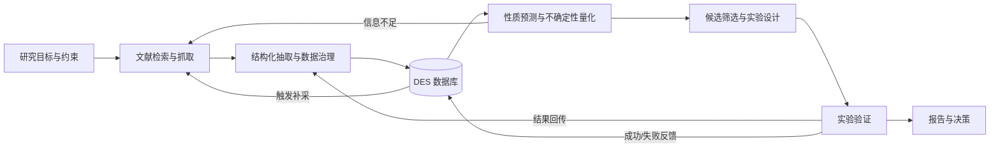
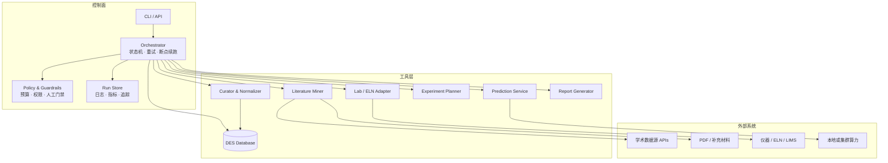

# DESCoplite

> 面向低共熔溶剂（Deep Eutectic Solvent, DES）发现的全闭环自动化研究 Harness。

DESCoplite 把**文献数据抓取 → 数据治理与入库 → DES 性质预测 → 实验验证**组织成一个可编排、可审计、可复现的自动化闭环。研究者只需定义研究目标与约束，Harness 负责调度各阶段工具、管理数据与模型版本，并在实验结果回传后自动更新知识库、修正预测、生成下一轮候选配方。

当前状态：**早期设计阶段**。本仓库目前给出项目目标、闭环协议与模块接口约定，代码将按 [Roadmap](#roadmap) 逐步落地。

## 目录

- [为什么需要 Harness](#为什么需要-harness)
- [闭环工作流](#闭环工作流)
- [核心模块](#核心模块)
- [系统架构](#系统架构)
- [Harness 设计原则](#harness-设计原则)
- [规划中的目录结构](#规划中的目录结构)
- [快速开始（接口草案）](#快速开始接口草案)
- [配置示例](#配置示例)
- [核心数据模型](#核心数据模型)
- [质量、安全与可复现性](#质量安全与可复现性)
- [Roadmap](#roadmap)
- [贡献](#贡献)
- [License](#license)

## 为什么需要 Harness

DES 配方空间由氢键供体（HBD）、氢键受体（HBA）、摩尔比、温度、含水量等因素共同决定，文献数据分散、单位不一、实验条件缺失，单一模型或单次实验都无法高效覆盖。DESCoplite 不把流程做成一次性脚本，而是提供一个 **Harness**：

- 统一调度异构工具（检索、PDF 解析、LLM 抽取、数据库、预测模型、实验设备/ELN）；
- 为每一步保留输入、输出、参数、代码版本与证据链；
- 支持失败重试、断点续跑、预算控制与人工审核；
- 让“预测—实验—反馈”真正闭环，而不是停留在离线 benchmark。

## 闭环工作流



闭环中的每一次迭代都会产生新的实验数据，这些数据与文献数据使用同一套 schema 和溯源机制入库，并参与下一轮模型更新与候选生成。

## 核心模块

### 1. 文献数据抓取

从公开学术数据源检索 DES 相关文献，并抽取配方、组分、物性、实验条件与来源证据。

- 检索源：Crossref、OpenAlex、Semantic Scholar、PubMed 等（以插件方式接入）；
- 输入形态：DOI、标题/摘要、开放获取 PDF、补充材料；
- 抽取内容：HBA/HBD 组分、SMILES/InChIKey、摩尔比、温度、压力、含水量、物性值、单位、不确定度、实验方法；
- 证据保留：页码、表格/图编号、原文片段与抽取置信度；
- 支持表格解析、图数据数字化（digitization）与人工校正。

### 2. 数据治理与入库

将抽取结果转换为可查询、可比较、可追溯的标准化数据。

- Schema 校验与字段补全；
- 化学实体归一化（名称、别名、SMILES、InChIKey、分子式）；
- 单位与温标统一（如 mPa·s / Pa·s、°C / K）；
- 去重、冲突检测、异常值标记；
- 数据版本化与变更审计；
- 文献数据与实验数据使用同一套数据模型，但保留 `source_type` 区分。

### 3. DES 性质预测

以插件形式接入不同预测后端，输出点预测、不确定度与适用域判断。

- 目标性质：熔点、粘度、密度、电导率、含水量影响等；
- 模型类型：物理启发模型、经典机器学习、图神经网络、迁移学习等；
- 不确定性量化：集成、贝叶斯方法或 conformal prediction；
- 适用域（applicability domain）检测与置信度分级；
- 逆向设计/配方排序：在目标性质与约束下生成候选；
- 数据切分按文献/时间/组分骨架分组，避免信息泄漏。

### 4. 实验验证

把预测候选转化为可执行的实验计划，并将结果结构化回传。

- 候选筛选：多目标排序、约束满足、成本与可得性检查；
- 实验设计：DOE、主动学习、贝叶斯优化；
- 实验协议生成：配比、温度程序、测量方法、重复次数；
- 实验室适配器：ELN、LIMS、仪器文件或人工录入（接口可插拔）；
- 结果回传：自动校验、入库、触发模型更新与下一轮迭代；
- 安全门禁：SDS/兼容性/危化品规则检查与人工确认。

## 系统架构



所有模块通过**带类型的工具契约**接入 Harness：声明输入/输出 schema、资源需求、权限、重试策略与幂等性。工具可以是本地 Python 函数、HTTP 服务、容器任务或需要人工执行的步骤。

## Harness 设计原则

1. **Provenance-first**：每个数值都能追溯到文献原文、实验记录或模型输出，禁止无来源数据。
2. **Human-in-the-loop**：抽取结果确认、实验方案审批、安全审查等关键节点默认需要人工门禁。
3. **不确定性与适用域**：预测结果必须同时给出置信度与适用域，避免把外推结果当作事实。
4. **可恢复与幂等**：长流程支持 checkpoint、失败重试与断点续跑；重复执行不产生重复数据。
5. **可审计**：记录运行配置、随机种子、代码版本、模型版本、数据版本与完整 artifact。
6. **插件化**：文献源、预测后端、数据库、实验设备均可替换，不绑定单一实现。
7. **预算与安全**：对 API 调用、算力、实验次数设置预算；危险实验强制人工确认。
8. **Mock 优先**：所有外部依赖提供 mock/fixture 模式，便于离线开发和测试。

## 规划中的目录结构

```text
DESCoplite/
├── src/descoplite/
│   ├── cli.py                  # 命令行入口
│   ├── orchestrator/           # 状态机、调度、checkpoint、重试
│   ├── tools/
│   │   ├── literature/         # 检索、PDF 解析、抽取
│   │   ├── curation/           # 归一化、去重、校验
│   │   ├── database/           # 数据访问与版本管理
│   │   ├── prediction/         # 预测后端适配器
│   │   └── experiment/         # 实验设计、ELN/仪器适配器
│   ├── schemas/                # Pydantic / JSON Schema 数据契约
│   ├── policies/               # 预算、安全、人工门禁规则
│   ├── reporting/              # 运行报告与可视化导出
│   └── artifacts/              # artifact 存储与寻址
├── configs/                    # 示例 campaign 配置
├── data/                       # 本地数据（git 忽略）
├── docs/                       # 设计与接口文档
├── tests/                      # 单元测试与端到端 fixture
├── pyproject.toml
└── README.md
```

## 快速开始（接口草案）

以下命令为规划中的目标接口，尚未实现：

```bash
git clone https://github.com/<owner>/DESCoplite.git
cd DESCoplite
python -m venv .venv
.venv\Scripts\activate        # Windows
pip install -e ".[dev]"

descoplite doctor
descoplite run configs/campaign.example.yaml --dry-run
descoplite run configs/campaign.example.yaml
descoplite report runs/<run_id>
```

`--dry-run` 只执行检索、规划和校验，不调用付费 API、不写入生产数据库、不提交实验。

## 配置示例

```yaml
campaign:
  name: low-viscosity-des-screen
  objective:
    property: viscosity
    target:
      value: 50
      unit: mPa.s
      temperature_k: 298.15
    constraints:
      max_components: 3
      available_only: true
      water_content_wt: "< 0.5"

  literature:
    sources: [crossref, openalex]
    query: "deep eutectic solvent viscosity choline chloride"
    year_from: 2015
    max_records: 2000

  curation:
    normalize_units: true
    deduplicate: true
    min_confidence: 0.7

  prediction:
    model: ensemble
    uncertainty: conformal
    applicability_domain: true

  experiment:
    design: bayesian_optimization
    batch_size: 8
    max_experiments: 32
    require_approval: true

  policy:
    max_api_cost_usd: 20
    max_compute_hours: 8
    seed: 42
```

## 核心数据模型

| 实体 | 说明 |
|------|------|
| `Paper` | 文献元数据（DOI、标题、年份、来源、许可） |
| `SourceSpan` | 抽取证据（页码、表格/图、原文片段、置信度） |
| `Component` | 化学组分（名称、别名、SMILES、InChIKey、HBA/HBD 角色） |
| `Formulation` | 配方（组分集合、摩尔比、制备条件） |
| `Measurement` | 物性测量（性质、值、单位、温度、方法、不确定度、来源） |
| `Prediction` | 模型预测（模型版本、输入、输出、不确定度、适用域） |
| `Experiment` | 实验记录（方案、执行状态、原始数据、结果） |
| `Campaign` | 一次研究活动（目标、约束、预算、迭代历史） |
| `Artifact` | 运行产物（文件、日志、模型、报告）及其内容哈希 |

文献测量与实验测量共享 `Measurement` 结构，通过 `source_type`（`literature` / `experiment`）和 `provenance` 区分。

## 质量、安全与可复现性

- **数据质量**：schema 校验、单位换算检查、重复与冲突检测、异常值标记；
- **防泄漏**：按 DOI、时间或化学骨架分组切分训练/验证集；
- **模型质量**：固定随机种子，记录数据与模型版本，报告校准误差与适用域覆盖率；
- **实验安全**：危化品与兼容性规则检查，危险步骤必须人工批准；
- **权限与密钥**：API key 通过环境变量或密钥管理器注入，不写入仓库与运行日志；
- **可复现**：每次 run 生成不可变 manifest，支持从 artifact 重建结果。

## Roadmap

- [ ] **M0 脚手架**：项目结构、依赖管理、CLI、配置 schema、orchestrator 状态机、mock 工具链
- [ ] **M1 文献闭环**：检索 → PDF/表格解析 → LLM 抽取 → 证据定位 → 人工校正
- [ ] **M2 数据闭环**：归一化、去重、冲突处理、版本化入库、导入导出
- [ ] **M3 预测闭环**：预测后端接口、基线模型、不确定性量化、适用域、离线 benchmark
- [ ] **M4 实验闭环**：候选生成、实验设计、ELN/仪器适配器、结果回传、自动再训练
- [ ] **M5 端到端演示**：小规模真实 campaign，完整复现实验与运行报告
- [ ] **M6 平台化**：Web dashboard、多用户、任务队列、成本与实验预算管理

## 贡献

项目处于早期阶段，接口与 schema 仍可能调整。欢迎通过 Issue 讨论需求、数据标准与实验接入方式。提交代码前请确保：

- 新增工具实现带类型的输入/输出契约；
- 外部依赖提供 mock 或 fixture；
- 测试覆盖关键数据转换与失败路径；
- 不提交密钥、受版权保护的文献全文或未脱敏实验数据。

## License

待定（TBD）。
